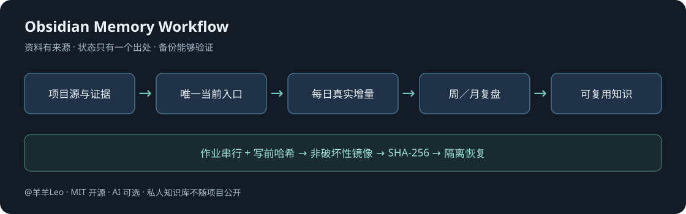

# Obsidian Memory Workflow

### Obsidian × AI 长期记忆工作流 · 由 @羊羊Leo 分享

[](LICENSE)

**让 AI 记住项目进展，但不把聊天摘要当事实、不重复生成待办，也不把“文件复制成功”当作备份完成。**

这是一个本地优先、可追溯、可回退的知识管理起步仓库：提供 Obsidian 示例库、日／周／月整理模板、AI 协作提示词，以及并发保护、写前检查和备份验证脚本。你可以全手动使用，也可以接入自己已经在用的 AI 工具。

开源的是方法、模板与辅助代码，**不是作者的私人知识库**。所有示例项目和记录均为虚构；本仓库不含聊天记录、账户配置、运行记忆或客户资料。

## 新用户：一键准备自己的工作区

**[下载 v0.2.0](https://github.com/yangyangleo-ai/obsidian-memory-workflow/releases/tag/v0.2.0)** → 解压 → Windows 双击 **`install.cmd`**。

它会在当前用户目录新建 `AI-Memory-Workspace`，复制公开模板、跨 AI 入口和练习，
逐文件读回校验，不覆盖已有知识库。Windows 安装本身不需要 Python、Node、付费插件或管理员权限。
然后按新目录 `START_HERE.md`，在 Obsidian 打开 `vault-template`，在 AI 编程工具打开工作区根目录。

macOS / Linux 有 Python 3.11+ 时可运行 `python3 scripts/install_workspace.py`；
这些平台的原生实测范围单独标注，不宣称全平台均已通过。
详见 [安装与重复运行](docs/installation.md) 和 [跨 AI 使用](docs/ai-compatibility.md)。

**一键完成文件准备，不等于所有 AI 自动接通。** 不安装 Obsidian 软件，不登录账号、不接模型、
不上传笔记、不启用日周月自动化。不同工具可通过 AGENTS.md、CLAUDE.md、GEMINI.md、
Cursor/Copilot 项目指令读同一份 `AI_START_HERE.md`；聊天网页则手动提供已审阅的交接资料。
用同一组五道题验证一次交接，不用宣传语替代理解验收。



## 它解决什么问题

| 常见问题 | 这套工作流的约束 |
| --- | --- |
| AI 把旧计划写成“已完成” | 项目源文件和最新验收证据优先；事实、决定、推断、未知分开 |
| 同一个进度在首页、日报、档案里有多个版本 | 当前状态只有一个主入口，其余页面引用 |
| 每天重读全部历史，生成重复流水账 | 从上次已核验扫描截止取增量，用内容指纹去重；没有有效变化不造日报 |
| 日任务和周任务同时写库 | 整轮作业门串行，写入另有独占 guard；冲突停止，不删锁 |
| 收藏文章越来越多，却不知道是否可信 | 资料与知识卡分层，出处、访问日期与断言核实状态分开 |
| “有备份”，但真正恢复时才发现漏文件 | 非破坏性镜像 + 全文件 SHA-256 + 独立目录恢复检查 |

## 五分钟开始：不需要 AI，也不需要社区插件

1. [下载 ZIP](https://github.com/yangyangleo-ai/obsidian-memory-workflow/archive/refs/heads/main.zip)，解压到一个**新目录**。不要覆盖已有知识库。
2. 用 Obsidian 的“打开本地仓库”打开 `vault-template` 文件夹。
3. 从 `首页.md` 进入示例项目，查看“当前结论 → 来源 → 下一步”的关系。
4. 把虚构项目换成自己的项目入口；新资料使用 `06-模板/资料摘录模板.md`。
5. 先跑通一次手动整理，再考虑 AI 与定时任务。带 `{{...}}` 的字段是占位符，不会由本仓库自动填充。

原生 Bases 是可选增强：启用后能看到资料索引、待分流、有效知识、待复核四个表。未启用时直接用 Markdown 链接，不影响手动使用。本项目只做静态语法／范围检查，**不把它当作 Obsidian 界面验收**。详见 [快速开始](docs/quickstart.md)。

## 先走通三个小练习

v0.2.0 包含以下三条练习，固定 v0.1.0 仍保留；不是所有 AI 自动接通，也不会上传资料、创建模型账号或安装插件。

| 想先解决什么 | 直接开始 | 会留下什么 |
| --- | --- | --- |
| 换 AI 时不重讲项目 | [跨 AI 交接演练](docs/cross-ai-handover.md) | 只含三份选定笔记的只读交接包、来源哈希和五项理解检查 |
| 网页看过以后找不到 | [网页资料捕获](docs/web-capture.md) | 官方 Clipper 可导入模板，或无扩展的摘录卡；来源与未知保留 |
| 从选题到发布混成一团 | [创作者完整案例](docs/creator-case.md) | 全虚构视频项目：采用决定、素材许可、唯一下一步与内容链路 |

[版本与可选插件](docs/compatibility.md) 单独说明兼容性；最低版本符合、结构测试通过、实际界面通过和某个 AI 理解通过分别记录。无需社区插件也能完成上述练习。

## 三种使用方式

| 方式 | 需要什么 | 会发生什么 |
| --- | --- | --- |
| 手动整理 | Obsidian 或普通 Markdown 编辑器 | 使用目录、规则与模板；不运行任何模型或脚本 |
| AI 辅助 | 你已有的 AI 编程／文件助手 | 按 [提示词](prompts/README.md) 读取指定来源、提炼变化；仍需你配置路径和权限 |
| 定时整理 | 上述 AI 工具自己的调度能力 | 自行配置日／周／月触发与持久状态；本仓库**不创建定时任务，也不是后台 Agent 服务** |

示例安排是 Asia/Shanghai 每日 22:00、周日 22:30、每月 1 日 23:15；月复盘针对上一完整自然月。时间可以改，不绑定任何具体模型／订阅。模型参数、账户和调度器由使用者管理，仓库不会安装插件、接入模型、下单或发布内容。

## 日／周／月各做一件不同的事

- **每日：收增量。** 只记录新事实、有效决定、风险与下一步；无法读取的范围保留缺口，失败不推进其游标。
- **每周：做判断。** 在已验证范围里复查假设、反例和重复阻塞，选择最多三个优先级；引用原任务，不复制待办状态。
- **每月：看长期。** 复盘上一自然月的目标与决定，提炼真正可复用的方法，并单独检查备份能否恢复。

`coverage_status`、`write_status`、`mirror_status` 分开记录：允许“部分范围已整理、文件已提交、镜像已核验”同时成立，不能把它包装成全部成功。详见 [工作流设计](docs/workflow.md) 和 [属性规范](docs/schema.md)。

## 仓库里有什么

```text
vault-template/       可直接打开的全虚构示例库与 7 份模板
prompts/              手动、每日、每周、每月 AI 整理说明
scripts/              Windows 作业门／写锁 + Python 安全写入／备份工具
tests/                只使用临时目录与虚构数据的本地测试
docs/                 上手、设计、安全、备份、教学提纲与常见问题
examples/             无真实数据的配置清单和回执示例
```

`scripts/handover.py` 只在本机导出指定 Markdown 并检查源变化；`scripts/capture_source.py` 默认只预览用户提供的公开摘录，加 `--apply` 才新建资料卡。两者不联网、不调用模型、不修改既有项目状态；真实库写入仍须独立持有 guard。

### 辅助脚本的范围

Python 工具仅使用标准库，要求 Python 3.11+。并发 guard 以 Windows + PowerShell 7 为支持基线。**备份／写入工具本身不替你取得两个 guard**；写真实库时必须由持有作业门及写锁的协作流程调用。guard 也不能阻止不遵守约定的编辑器，因此写前还要比较哈希。

```powershell
# 在仓库目录执行。测试只操作隔离临时目录，不读取个人知识库。
python -m unittest discover -s tests -v
python scripts/check_public_content.py
```

真实路径、锁会话、镜像和恢复步骤见 [安全操作指南](docs/operations.md)。不要跳过文档，直接把自动化提示词接入生产知识库。

首版已经在 Windows 本地运行 40 项 Python 测试与 32 项 guard 断言。线上 CI **尚未启用**；仓库提供 [可选 CI 配置与启用说明](docs/ci-setup.md)，需要维护者自行确认工作流写入权限。未运行的 Linux／远端测试不宣称通过。

v0.2.0 在 Windows 本机通过 81 项 Python 测试（含 Windows PowerShell 5.1 安装测试）、
32 项 guard 断言及 94 个公开文件检查；完整分发源经 `install.cmd`、Windows PowerShell 5.1、
PowerShell 7 和 Python 四种入口安装、自检与重复运行演练。未在 macOS / Linux 原生或多家 AI
账号上实测，不把文件校验写成模型理解、安全审计或所有环境通过。

## 免费与授权

本仓库按 [MIT License](LICENSE) 开源，可以免费使用、修改和再分发，请遵守并保留版权与许可声明。没有收费墙、强制注册、遥测或内置模型请求。Obsidian 软件、可选同步服务和你选择的 AI 服务各自遵循其许可／费用；**仓库免费不等于第三方服务免费**。[Obsidian 许可说明](https://obsidian.md/license)。

本项目不是 Obsidian 官方产品，不提供投资、医疗或法律判断，也不承诺“AI 永不遗忘”“无人值守零风险”或效率提升比例。

## 教学、贡献与反馈

- 准备拍教学？从 [教学演示提纲](docs/teaching-outline.md) 开始，用虚构示例演示完整闭环，不录真实客户／账户／聊天。
- 分享链接：[github.com/yangyangleo-ai/obsidian-memory-workflow](https://github.com/yangyangleo-ai/obsidian-memory-workflow)。教学可以固定 [v0.1.0](https://github.com/yangyangleo-ai/obsidian-memory-workflow/releases/tag/v0.1.0)，避免后续文件变化。
- 反馈与提交改进前，请读 [贡献说明](CONTRIBUTING.md) 和 [安全说明](SECURITY.md)。不要把私人笔记或完整运行回执贴到 Issue。

本方案借鉴了 kepano、Web Clipper、Tasks 和 Obsidian Git 的部分理念，但不要求安装它们。出处与边界见 [致谢与借鉴](docs/credits.md)。
